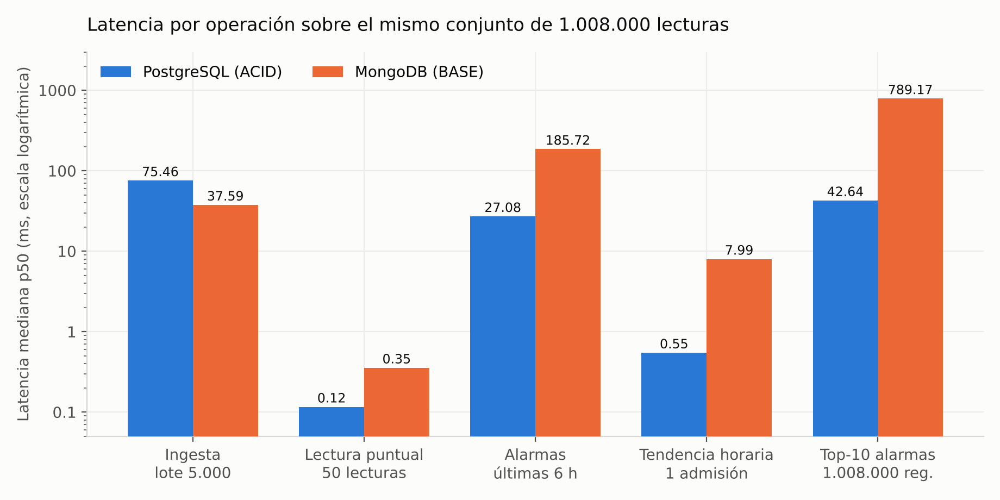
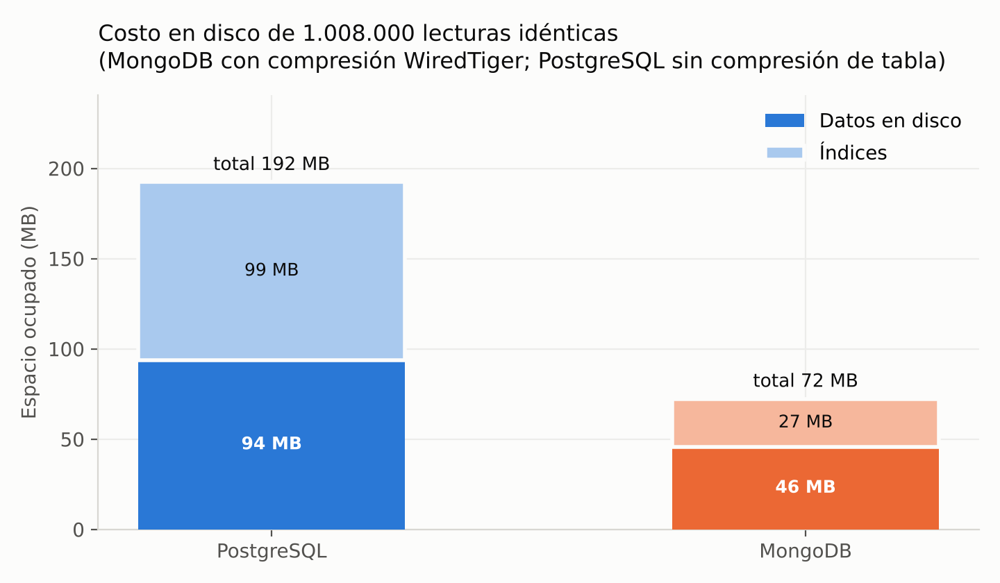
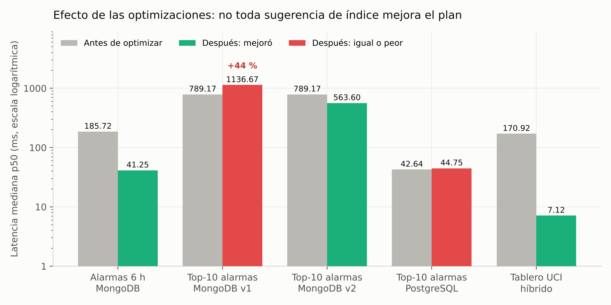

\newpage

# Contexto y alcance

## El problema

La HCE Básica que el equipo viene construyendo durante el semestre (base de datos
`BD_HCE_Antioquia`) resolvió en sus fases previas el modelo entidad-relación, el
DDL, el poblamiento y los objetos programados sobre un único motor relacional.
Ese diseño es correcto mientras el sistema solo registre lo que un ser humano
escribe: admisiones, diagnósticos, órdenes médicas, egresos.

El subsistema de hospitalización moderno, sin embargo, ya no solo registra lo que
un humano escribe. Una unidad de cuidado intensivo con 8 camas monitorizadas que
emite una lectura de signos vitales cada 30 segundos genera 23.040 registros
diarios; la red de 9 hospitales modelada en este trabajo, con 560 camas
monitorizadas, genera **1.612.800 lecturas por día**. A eso se suman las alarmas
de los monitores, las notas de enfermería, los eventos de los dispositivos, los
errores de sincronización de las integraciones HL7/FHIR y las teleconsultas con
su transcripción y sus adjuntos.

Esa segunda clase de datos tiene propiedades distintas de la primera:

- **Nace fuera del sistema** y llega en ráfagas, por una red que se cae.
- **Es inmutable**: una lectura de signos vitales no se corrige, se complementa.
- **Es heterogénea**: cada fabricante y cada protocolo emite campos distintos, y
  un sensor nuevo aparece sin avisar al administrador de la base de datos.
- **Tolera la inconsistencia momentánea**: que el tablero muestre la saturación
  de hace 20 segundos en lugar de la de hace 5 es aceptable; que muestre el
  nombre equivocado del paciente, no.

## El alcance de esta entrega

Se construyó una arquitectura de dos capas, se pobló con datos sintéticos
realistas y se midió. Todo lo que se afirma en el análisis está respaldado por una
ejecución reproducible incluida en el repositorio: los scripts, los datos de
prueba, los planes de ejecución y las métricas crudas.

No se implementó el despliegue en alta disponibilidad (réplicas, *sharding*), que
excede el alcance de la unidad; sí se documenta cómo el modelo elegido se
proyecta sobre él, porque de ahí sale buena parte del argumento CAP. Tampoco se
implementó la capa de aplicación (API e ingesta en línea): el diagrama la incluye
porque es donde viven las reglas de orquestación, pero lo construido y medido son
las dos capas de persistencia.

\newpage

# Justificación de la arquitectura híbrida

## El punto de partida: el teorema CAP

El teorema CAP establece que un sistema distribuido no puede garantizar
simultáneamente consistencia (C), disponibilidad (A) y tolerancia a particiones
de red (P). Como la partición no es una opción de diseño sino un hecho de la vida
de cualquier red hospitalaria —un enlace entre Apartadó y Medellín se cae, una
red Wi-Fi de UCI se congestiona—, la P está dada, y la decisión real es **qué se
sacrifica cuando la partición ocurre: la consistencia o la disponibilidad**.

Conviene enunciar con precisión algo que suele simplificarse: **ni PostgreSQL es
«CP» ni MongoDB es «AP» por naturaleza**. Un *replica set* de MongoDB con
`writeConcern: "majority"` —el valor por omisión desde la versión 5.0— se
comporta como CP: ante una partición, la minoría deja de aceptar escrituras.
PostgreSQL con replicación asíncrona se comporta como AP: el primario sigue
aceptando escrituras que la réplica aún no tiene. **Lo que fija la posición en
CAP es el nivel de sincronía exigido a cada escritura**, no la marca del motor.

Esa es precisamente la razón de ser de la arquitectura híbrida, y la clave de
este trabajo: la pregunta de qué sacrificar **no tiene una sola respuesta para
todo el sistema**. Tiene una respuesta distinta para cada clase de dato:

> Si la red se parte en el momento en que llega una lectura de saturación de
> oxígeno, lo correcto es **aceptarla** y resolver después el orden
> (disponibilidad). Si la red se parte en el momento en que dos sedes intentan
> asignar la misma cama al mismo tiempo, lo correcto es **rechazar la operación**
> antes que permitir dos pacientes en una cama (consistencia).

Un sistema de un solo motor y una sola política de escritura obliga a elegir una
de las dos para todo. La arquitectura híbrida permite aplicar cada política donde
corresponde, y hacerlo además con el motor cuyo modelo de datos encaja mejor con
cada clase de información. Esa es su justificación, y no la moda tecnológica ni
el rendimiento por sí mismo.

## El modelo ACID frente al modelo BASE

| Dimensión | ACID (PostgreSQL, como se usa aquí) | BASE (MongoDB, como se usa aquí) |
|---|---|---|
| Garantía principal | Atomicidad, consistencia, aislamiento, durabilidad | *Basically Available, Soft state, Eventually consistent* |
| Política de escritura adoptada | Transaccional y sincrónica: el `COMMIT` espera al WAL | `w:1`, `j:false`: confirma antes de garantizar el disco |
| Posición CAP resultante | CP: ante partición se rechaza la escritura | AP: ante partición se acepta y se converge después |
| Esquema | Rígido, declarado y verificado por el motor | Flexible, verificado parcialmente por validadores |
| Unidad de integridad | La transacción sobre varias tablas | El documento individual |
| Costo de cambiar el modelo | Migración (DDL + *backfill* + despliegue) | Nulo: conviven formas distintas |
| Escalamiento natural | Vertical; horizontal con réplicas y particionado | Horizontal por *sharding* de la clave |
| Pregunta que responde bien | «¿Quién es este paciente y qué se le hizo?» | «¿Qué ha estado emitiendo este paciente?» |

## La regla de decisión aplicada al subsistema

Para repartir las entidades se aplicaron tres preguntas en orden. Basta que la
primera se responda «sí» para que el dato se quede en la capa ACID:

1. **¿Un error en este dato puede dañar a un paciente o invalidar un acto
   médico?** → Identidad, admisión, cama, profesional tratante, egreso.
2. **¿Este dato participa en una invariante que involucra a varias entidades?**
   → «Una cama, una admisión abierta»; «un paciente, una hospitalización
   simultánea en la red»; «el egreso cierra la admisión *y* libera la cama *y*
   retira el dispositivo».
3. **¿Alguien va a actualizar este dato después de escrito?** → Si la respuesta
   es no y el volumen es alto, el dato pertenece a la capa BASE.

El resultado es la siguiente asignación:

| Dato | Capa | Motivo dominante |
|---|---|---|
| `paciente` (identidad, documento) | **ACID** | Unicidad de documento en toda la red; error = confusión de pacientes |
| `admision` (estado, cama, médico) | **ACID** | Invariantes multi-entidad; base legal del acto asistencial |
| `sede`, `pabellon`, `cama` | **ACID** | Dato maestro, baja volatilidad, integridad referencial |
| `profesional`, `eps`, `CIE-10` | **ACID** | Catálogos verificables; referencia obligatoria |
| `admision_diagnostico` | **ACID** | Alimenta RIPS e indicadores; exige referencia válida a CIE-10 |
| `dispositivo`, `asignacion_dispositivo` | **ACID** | «Qué aparato lleva quién» es trazabilidad legal |
| `auditoria_egreso` | **ACID** | Debe escribirse en la misma transacción que el egreso |
| `telemetria` (signos vitales) | **BASE** | 1,6 millones de eventos/día, inmutables, tolerantes a retraso |
| `eventos_clinicos` (alarmas, notas, errores) | **BASE** | Esquema variable por tipo de evento |
| `teleconsultas` | **BASE** | Documento anidado completo: transcripción, adjuntos, calidad de red |

## La llave puente: quién manda sobre la identidad

El riesgo real de una arquitectura híbrida no es el rendimiento: es que la
identidad se duplique y las dos capas dejen de hablar del mismo paciente.

La regla adoptada —y la decisión de diseño más importante del trabajo— es:

> **PostgreSQL es el único emisor de identidad. MongoDB nunca genera un
> `uuid_paciente` ni un `uuid_admision`: solo los referencia.**

Lo que está implementado en esta entrega para sostener esa regla es:

- Columnas `UUID NOT NULL UNIQUE DEFAULT gen_random_uuid()` en `paciente` y
  `admision` (`sql/01_schema.sql`): la capa ACID es la que emite el valor.
- Un validador `$jsonSchema` en la colección `telemetria` que declara
  `uuid_admision` y `medido_en` como campos requeridos
  (`nosql/01_init_colecciones.js`).
- El proceso de ingesta lee las llaves desde PostgreSQL antes de escribir en
  MongoDB (`scripts/02_ingesta_mongo.py`, función `contexto_desde_postgres`):
  ningún documento se construye con una identidad que el relacional no haya
  emitido.

Dos precisiones honestas sobre los límites de lo implementado, porque es fácil
afirmar de más en este punto:

**El validador advierte, no rechaza.** Está configurado como `validationLevel:
"moderate"` con `validationAction: "warn"` (la justificación clínica está en la
sección 3.2). Eso significa que un documento sin `uuid_admision` quedaría
registrado con una advertencia en el *log* del servidor, no descartado. Si se
quisiera que el motor lo rechazara habría que cambiar la acción a `"error"`, y
esa decisión implica aceptar que se pierdan lecturas.

**La cola de eventos huérfanos es diseño, no código.** El nodo 2 del diagrama
describe el comportamiento que un despliegue real necesitaría —encolar el evento
cuya identidad no se resuelve, en lugar de inventarla— pero esa capa de
aplicación no forma parte de esta entrega. Lo que sí está implementado es la
dirección del flujo: las llaves se leen de PostgreSQL y nunca al revés.

\begin{figure}[p]
\centering
\includegraphics[height=0.90\textheight]{figuras/fig0_arquitectura.png}
\caption{Arquitectura híbrida del subsistema de hospitalización. Las flechas gruesas son flujos de escritura; las punteadas, la resolución de identidad. La capa ACID escribe de forma sincrónica y transaccional; la capa BASE con \texttt{w:1}, no bloqueante. Fuente Mermaid en \texttt{docs/diagrama-arquitectura.mmd}.}
\end{figure}

\newpage

# Implementación

## Capa ACID — PostgreSQL 16

El esquema `hosp` contiene 13 tablas (12 del modelo de negocio más
`telemetria_signos`, la tabla espejo que solo existe para el benchmark), 5 tipos
enumerados, 2 dominios con restricción de formato, una vista de apoyo y un
procedimiento almacenado. El diseño apuesta por **declarar las reglas de negocio
en el motor** en lugar de confiarlas a la aplicación. Tres ejemplos que vale la
pena destacar:

**Índices únicos parciales como invariantes de negocio.** La regla «una cama no
puede tener dos admisiones abiertas» no se puede expresar con una restricción
`UNIQUE` ordinaria, porque la cama sí se repite entre admisiones cerradas:

```sql
CREATE UNIQUE INDEX uq_cama_ocupada_una_vez
    ON admision (id_cama) WHERE estado IN ('ABIERTA','EN_TRASLADO');

CREATE UNIQUE INDEX uq_paciente_una_admision_abierta
    ON admision (id_paciente) WHERE estado IN ('ABIERTA','EN_TRASLADO');
```

Esta es exactamente la clase de garantía que una base documental no puede ofrecer
sin construir un mecanismo de bloqueo en la aplicación —y una garantía
implementada en la aplicación es una garantía que se rompe el día que alguien
escribe por otra vía.

**Restricciones de coherencia de estado.** Una admisión cerrada sin fecha ni tipo
de egreso es un registro inválido, y el motor lo impide:

```sql
CONSTRAINT ck_admision_cierre CHECK (
    (estado = 'CERRADA' AND fecha_egreso IS NOT NULL AND tipo_egreso IS NOT NULL)
    OR (estado <> 'CERRADA'))
```

**Transacción multi-entidad para el egreso.** El procedimiento
`sp_egresar_paciente` toma un bloqueo pesimista sobre la admisión (`FOR UPDATE`),
cierra la admisión, registra el diagnóstico de egreso, pasa la cama a estado
`LIMPIEZA`, retira el dispositivo asignado e inserta la auditoría. Toca **cinco
tablas** (`admision`, `admision_diagnostico`, `cama`, `asignacion_dispositivo`,
`auditoria_egreso`) en una sola unidad atómica: si cualquiera de las operaciones
falla, la cama no queda libre con el paciente todavía adentro.

Volumen poblado: 20.000 pacientes, 8.000 admisiones (560 abiertas, ocupando cama
real), 11.389 diagnósticos asociados, 584 camas, 584 dispositivos, 126
profesionales en 9 sedes de 6 subregiones de Antioquia.

## Capa BASE — MongoDB 8.0

Tres colecciones, cada una justificada por una propiedad distinta del modelo
documental:

**`telemetria` — volumen y velocidad.** Un documento por lectura, con los signos
anidados en un subdocumento `signos`. El validador es deliberadamente permisivo:

```javascript
validationLevel: "moderate",
validationAction: "warn"   // no descarta el documento: lo registra y advierte
```

La decisión merece explicación, porque va contra el instinto formado en el mundo
relacional. En un flujo de telemetría, **perder una lectura es peor que recibirla
imperfecta**: una saturación de oxígeno fuera de rango puede ser un sensor mal
puesto, pero también puede ser un paciente desaturando. El sistema la acepta, la
marca y deja que el criterio clínico decida. Los campos que **sí** se declaran
obligatorios son los que hacen al documento trazable (`uuid_admision` y
`medido_en`); con `warn` su ausencia produce una advertencia y no un rechazo,
pero la declaración documenta el contrato y permite auditar las violaciones.

**`eventos_clinicos` — esquema variable.** Cinco tipos de evento conviven en una
colección, y cada uno trae campos que los demás no tienen: una alarma lleva
`parametro`, `umbral`, `severidad` y `atendida_en_seg`; una administración de
medicamento lleva `medicamento`, `dosis`, `via` y `verificacion_doble`; un error
de sincronización lleva un `payload_crudo` anidado con el protocolo y el
*checksum*. Modelar esto en PostgreSQL exigiría o una tabla por tipo (con *joins*
y `UNION` para consultarlas juntas), o una tabla ancha con decenas de columnas
nulas, o un patrón entidad-atributo-valor. Ninguna de las tres es mejor que una
colección de documentos.

**`teleconsultas` — agregado anidado.** Una teleconsulta completa es un solo
documento: participantes, transcripción turno por turno, adjuntos y métricas de
red. Se recupera entera en una sola lectura, sin reconstruirla desde cinco tablas.

Índices creados: compuesto `{uuid_admision, medido_en}` para el patrón de acceso
dominante; parcial sobre alarmas; compuesto para eventos por tipo; índice de
texto sobre la transcripción de las teleconsultas.

## Ingesta masiva simulada

El script `scripts/02_ingesta_mongo.py` simula el flujo real: lee de PostgreSQL
las 560 admisiones monitorizadas, genera 1.800 lecturas por admisión (15 horas
de monitoreo continuo a una lectura cada 30 segundos) y las inserta en lotes de
5.000 documentos con `insert_many(ordered=False)`. Se generan además 150.000
eventos clínicos y 5.000 teleconsultas.

El generador de datos (`scripts/comun.py`) usa **semilla fija** y asigna a cada
admisión uno de cinco perfiles fisiológicos (estable, séptico, respiratorio,
cardíaco, posquirúrgico) con una deriva lenta de mejoría o deterioro a lo largo
de la estancia. Esto importa por dos razones: las agregaciones devuelven
resultados con variación realista en lugar de valores planos, y —sobre todo— el
determinismo permite cargar **exactamente los mismos datos** en los dos motores,
que es la condición sin la cual la comparación de la sección siguiente no
significaría nada.

\newpage

# Operaciones evaluadas

Se definieron nueve operaciones. Cada una se implementó dos veces —una por motor—
resolviendo la misma pregunta de negocio sobre los mismos datos.

| ID | Operación | Pregunta de negocio |
|---|---|---|
| OP-1 | Ingesta de un lote de 5.000 lecturas | ¿Cuánto cuesta absorber la ráfaga de los monitores? |
| OP-2 | Últimas 50 lecturas de una admisión | ¿Qué le pasa al paciente de la cama 7? |
| OP-3 | Alarmas de las últimas 6 horas | ¿Dónde hay riesgo ahora mismo? |
| OP-4 | Tendencia horaria de una admisión | ¿Cómo evolucionó durante la noche? |
| OP-5 | Top-10 admisiones por alarmas | ¿Qué pacientes concentran los eventos críticos? |
| OP-6 | Tablero de UCI (consulta híbrida) | Identidad + último signo vital en una sola pantalla |
| OP-7 | Llega un sensor nuevo | ¿Cuánto cuesta cambiar el modelo? |
| OP-8 | Egreso hospitalario | ¿Puede el motor garantizar «todo o nada»? |
| OP-9 | Optimización con índices | ¿Cuánto se gana afinando el plan? |

Un ejemplo del par de implementaciones, para dar idea de la equivalencia
semántica buscada (el resto está en `sql/04_consultas.sql` y
`nosql/02_consultas_agregacion.js`):

**OP-4 en PostgreSQL**

```sql
SELECT date_trunc('hour', medido_en) AS hora,
       round(avg(fc),1), max(fc), min(spo2), round(avg(spo2),1),
       count(*) FILTER (WHERE alarma) AS alarmas
  FROM telemetria_signos
 WHERE uuid_admision = $1
 GROUP BY 1 ORDER BY 1;
```

**OP-4 en MongoDB**

```javascript
db.telemetria.aggregate([
  { $match: { uuid_admision: uuidDemo } },
  { $group: {
      _id: { $dateTrunc: { date: "$medido_en", unit: "hour" } },
      fc_promedio:   { $avg: "$signos.fc" },
      fc_maxima:     { $max: "$signos.fc" },
      spo2_minima:   { $min: "$signos.spo2" },
      spo2_promedio: { $avg: "$signos.spo2" },
      alarmas:       { $sum: { $cond: ["$alarma", 1, 0] } } } },
  { $sort: { _id: 1 } } ]);
```

## Condiciones de la medición

Para que la comparación sea defendible se igualaron las condiciones:

- **Mismos datos**: 1.008.000 lecturas idénticas, generadas con semilla fija.
- **Mismo tipo de estructura de destino en la ingesta**: una **tabla permanente**
  de PostgreSQL (con WAL y MVCC) contra una **colección normal** de MongoDB. Se
  descartó expresamente usar una tabla temporal: las tablas temporales de
  PostgreSQL no escriben WAL, y medirlas contra una colección normal le regalaría
  al motor relacional una ventaja que en producción no tendría.
- **Mismos índices durante la carga y la consulta**: PostgreSQL con clave
  primaria + `(uuid_admision, medido_en DESC)` + índice parcial sobre alarmas;
  MongoDB con `_id` + `{uuid_admision, medido_en}` + índice parcial sobre
  alarmas. **Tres estructuras por motor**; los índices de cobertura de OP-9 se
  crean después de tomar todas las mediciones de línea base y de almacenamiento.
- **Mismo tamaño de lote** en la ingesta: 5.000 registros.
- **Warmup descartado** (3 ejecuciones; 1 en OP-8, que consume admisiones
  abiertas) y **30 repeticiones medidas** por operación; 10 en las agregaciones
  globales por su duración, y una sola ejecución en las operaciones de cambio de
  esquema (OP-7), que son irrepetibles por naturaleza.
- Se reportan **p50, p95 y p99**, no solo el promedio: en un sistema de monitoreo
  clínico la cola de la distribución es justamente lo que decide si una alarma
  llega a tiempo.
- Ambos motores en la misma máquina (2 vCPU, 7 GB RAM), PostgreSQL por *socket*
  Unix y MongoDB por TCP sobre *loopback*. La diferencia de transporte favorece
  marginalmente a PostgreSQL en las operaciones de latencia submilisegundo
  (OP-2); se señala explícitamente al interpretar ese resultado.

\newpage

# Análisis cuantitativo

## Resultados medidos

Latencias en milisegundos. Ejecución del 22 de noviembre de 2026 sobre
PostgreSQL 16.15 y MongoDB 8.0.23; salida completa en
`evidencias/09_benchmark.log` y datos crudos en `bench/resultados/metricas.csv`.

| Operación | Motor | p50 | p95 | p99 | n |
|---|---|---:|---:|---:|---:|
| OP-1 Ingesta lote 5.000 | PostgreSQL | 75,46 | 90,64 | 92,73 | 30 |
| OP-1 Ingesta lote 5.000 | **MongoDB** | **37,59** | 52,57 | 58,20 | 30 |
| OP-1 Ingesta lote 5.000 (COPY) | PostgreSQL | 13,81 | 15,38 | 15,97 | 30 |
| OP-2 Últimas 50 lecturas | **PostgreSQL** | **0,12** | 0,16 | 0,18 | 30 |
| OP-2 Últimas 50 lecturas | MongoDB | 0,35 | 0,42 | 0,42 | 30 |
| OP-3 Alarmas últimas 6 h | **PostgreSQL** | **27,08** | 28,09 | 28,09 | 30 |
| OP-3 Alarmas últimas 6 h | MongoDB | 185,72 | 189,60 | 190,42 | 30 |
| OP-4 Tendencia horaria | **PostgreSQL** | **0,55** | 0,58 | 0,59 | 30 |
| OP-4 Tendencia horaria | MongoDB | 7,99 | 9,14 | 9,22 | 30 |
| OP-5 Top-10 por alarmas | **PostgreSQL** | **42,64** | 43,34 | 43,34 | 10 |
| OP-5 Top-10 por alarmas | MongoDB | 789,17 | 798,46 | 798,46 | 10 |
| OP-6 Tablero UCI (híbrido) | PG + Mongo | 170,92 | 182,71 | 184,78 | 30 |
| OP-6 Tablero UCI optimizado | **PG + Mongo** | **7,12** | 7,85 | 8,03 | 30 |
| OP-8 Egreso transaccional | PostgreSQL | 0,30 | 0,48 | 0,54 | 30 |
| OP-8 Egreso transaccional | MongoDB | rechazado | — | — | — |



## Ingesta: la capa BASE gana donde se le pidió que ganara

MongoDB absorbe el lote de 5.000 lecturas en 37,59 ms frente a 75,46 ms de
PostgreSQL: **2,0× más rápido**, equivalente a 133.000 documentos/s contra 66.300
filas/s. Extrapolado a la carga de la red —1.612.800 lecturas diarias—, la
diferencia es de 12,1 s contra 24,3 s de tiempo de motor al día. En cifras
absolutas ambos sobran; lo que importa es el **margen ante el pico**, y ahí el
factor 2 es la diferencia entre encolar y no encolar cuando entran de golpe las
lecturas acumuladas durante un corte de red.

El resultado se explica por una diferencia de *promesas* antes que de
implementación. PostgreSQL parsea y planifica una sentencia `INSERT` de 5.000
tuplas, escribe el registro de transacciones (WAL) y mantiene la visibilidad
MVCC, y el `COMMIT` no retorna hasta que el WAL está en disco. MongoDB, con
`w:1, j:false`, confirma la escritura cuando el documento está en memoria del
primario, antes de que el *journal* se haya sincronizado. **MongoDB no es más
rápido por ser más moderno: es más rápido porque promete menos**, y en telemetría
esa promesa menor es aceptable; en el registro de un egreso, no.

La tercera barra de la figura 3 es importante para no sacar la conclusión
equivocada: con `COPY`, su vía nativa de carga masiva, PostgreSQL alcanza 362.000
filas/s, **2,7× más rápido que MongoDB**, y sin renunciar a la durabilidad. El
motor relacional no es intrínsecamente lento en ingesta; lo es cuando se le pide
ingerir por el camino transaccional. Esto matiza el argumento habitual de que
«NoSQL escala y SQL no»: la comparación honesta depende de qué interfaz se use.
Lo que `COPY` no ofrece es el flujo continuo por registro que la telemetría
necesita, y de ahí que la capa BASE siga siendo la elección correcta para el caso.


## Lectura y agregación: la capa ACID gana por un margen amplio

En las cuatro operaciones de consulta, PostgreSQL fue más rápido:

- OP-2 (lectura puntual por índice): 3,1× más rápido. Parte de la diferencia es
  transporte (*socket* Unix contra TCP), no motor; es el único resultado cuya
  interpretación hay que atenuar.
- OP-3 (ventana temporal sobre ~400.000 registros): 6,9× más rápido.
- OP-4 (agregación de 1.800 documentos): 14,6× más rápido.
- OP-5 (agregación sobre el dataset completo): **18,5× más rápido**.

La razón de fondo es el **costo por registro procesado**. El ejecutor de
PostgreSQL recorre tuplas de ancho fijo en páginas de 8 KB y además paraleliza:
el plan de OP-5 guardado en `bench/resultados/planes.txt` muestra
`Parallel Seq Scan` con dos *workers* y `Partial HashAggregate`. El *pipeline* de
agregación de MongoDB, cuyo plan de línea base es un `COLLSCAN`, materializa
documentos BSON y evalúa expresiones sobre ellos uno a uno, en un solo hilo por
*pipeline*. Cuando hay que tocar 330.000 documentos para contar alarmas, esa
diferencia de costo unitario se multiplica.

Hay además un factor de modelo: en MongoDB la agregación debe navegar
`$signos.fc`, un campo anidado dentro del documento, mientras PostgreSQL lee una
columna `SMALLINT` en una posición fija de la tupla. La flexibilidad del
documento se paga en cada lectura.

## Almacenamiento

El mismo millón de lecturas, con los tres índices que el diseño propone por
motor, ocupa:

| | Datos | Índices | Total |
|---|---:|---:|---:|
| PostgreSQL | 93,8 MB | 98,6 MB | **192,5 MB** |
| MongoDB (comprimido) | 45,7 MB | 26,6 MB | **72,3 MB** |

MongoDB ocupa **2,7× menos disco**. La ventaja no viene del modelo documental
—que es intrínsecamente más verboso, porque repite el nombre de cada campo en
cada documento: 255,7 MB sin comprimir frente a 93,8 MB de PostgreSQL— sino de la
**compresión Snappy por bloque de WiredTiger**, que reduce esos 255,7 MB a
45,7 MB. En un escenario de telemetría, donde los valores vecinos se parecen
mucho, la compresión trabaja a favor. PostgreSQL podría acercarse con
particionado y compresión del sistema de archivos, pero no comprime la tabla por
sí mismo.

Proyectado a un año de operación de la red (589 millones de lecturas): ~42 GB en
MongoDB (27 GB de datos comprimidos más 16 GB de índices) frente a ~113 GB en
PostgreSQL (55 GB de datos más 58 GB de índices). Ninguno de los dos es
prohibitivo a esta escala, pero el perfil de crecimiento difiere en un factor de
2,7 y debe planearse.



## OP-7: el costo de cambiar el modelo

Llega a la red un glucómetro continuo que emite dos campos que ningún dispositivo
anterior emitía (`glucosa_mgdl`, `etco2`).

| Motor | Acción | Tiempo | Efecto |
|---|---|---:|---|
| PostgreSQL | `ALTER TABLE ADD COLUMN` ×2 | 0,85 ms | Solo catálogo: una columna que admite nulos no reescribe la tabla |
| PostgreSQL | *Backfill* de 1.800 filas | 6,98 ms | Reescritura de tuplas por MVCC |
| MongoDB | Insertar 100 documentos con la forma nueva | 1,44 ms | Cero migraciones; dos formas de documento conviven |

Las filas no son comparables entre sí y no deben leerse como un duelo: en MongoDB
el equivalente exacto del `ALTER TABLE` es **no hacer nada**, y lo que se midió es
sencillamente cuánto tarda en aceptar documentos con una forma que antes no
existía. El punto no es el milisegundo: es la columna de la derecha.

El número del lado relacional también engaña si se lee solo. El `ALTER TABLE` es
barato en el motor, pero el costo real de un cambio de esquema relacional está
fuera del motor: revisión del DDL, ventana de despliegue, actualización de las
vistas y del ORM, pruebas de regresión, coordinación con el equipo de
integración. El *backfill* sí es caro y crece linealmente: 6,98 ms por 1.800
filas proyecta a ~65 minutos sobre mil millones de filas, y esa operación bloquea
escrituras sobre las filas afectadas.

En MongoDB el cambio no existe como evento: el dispositivo nuevo empieza a
escribir y la colección acepta las dos formas. Lo que se paga es **más tarde y en
otro lugar**: cada consulta debe contemplar que el campo pueda no existir, y esa
complejidad no desaparece, se traslada al código de la aplicación y al analista
de datos.

## OP-8: la propiedad que no se puede medir en milisegundos

El egreso hospitalario toca cinco tablas y debe ser atómico. PostgreSQL lo
ejecuta en 0,30 ms (p50) con garantía de «todo o nada».

Para el lado documental se construyó el equivalente más cercano: tres escrituras
sobre dos colecciones que deben ocurrir juntas o no ocurrir —registrar el evento
de egreso, marcar el dispositivo como retirado y cerrar las alarmas abiertas de
esa admisión— agrupadas en una transacción de MongoDB. El resultado quedó
registrado en `bench/resultados/planes.txt`:

```
RECHAZADA por el motor: OperationFailure: Transaction numbers are only
allowed on a replica set member or mongos
```

El hallazgo es instructivo y conviene enunciarlo con precisión: **MongoDB sí
soporta transacciones multi-documento desde la versión 4.0**, pero exige un
despliegue en *replica set* o *sharded cluster*; un nodo único las rechaza. Lo
que esta medición demuestra, entonces, no es que MongoDB sea incapaz de ejecutar
el egreso, sino que **la atomicidad multi-entidad no viene incluida: hay que
pagarla con topología**. Y aun habilitándola, la documentación del propio motor
recomienda no apoyar el diseño en ella, porque su costo crece con la duración y
el alcance de la transacción.

Este es el argumento más fuerte a favor de la división propuesta: el egreso de un
paciente no es un caso de uso para el que convenga forzar la capa documental.

## OP-9: optimización, y por qué hay que medirla

Se pidió a la IA sugerir índices de cobertura para las dos operaciones más
costosas. Las sugerencias se implementaron y **se midieron antes de darlas por
buenas**. El resultado fue desigual:

| Caso | Antes | Después | Resultado |
|---|---:|---:|---|
| OP-3 alarmas 6 h (MongoDB) | 185,72 ms | **41,25 ms** | 4,5× mejor |
| OP-3 alarmas 6 h (PostgreSQL) | 27,08 ms | 24,59 ms | 1,1× mejor (marginal) |
| OP-5 top-10 (MongoDB, índice v1) | 789,17 ms | 1.136,67 ms | **1,44× peor** |
| OP-5 top-10 (MongoDB, índice v2) | 789,17 ms | **563,60 ms** | 1,40× mejor |
| OP-5 top-10 (PostgreSQL) | 42,64 ms | 44,75 ms | Sin ganancia |
| OP-6 tablero UCI (reorquestación) | 170,92 ms | **7,12 ms** | 24,0× mejor |



Tres lecciones, cada una respaldada por una medición y por un plan de ejecución
guardado en el repositorio:

**El índice `{alarma, medido_en, uuid_admision}` mejoró OP-3 y empeoró OP-5.** En
OP-3 el filtro por rango de tiempo aprovecha el orden del índice y la consulta
queda cubierta: 4,5× más rápida. En OP-5 no hay filtro temporal, así que el motor
recorre un índice ordenado por tiempo para agrupar por otra clave, lo que resulta
más caro que leer la colección de corrido. El índice correcto para una agrupación
es el que ordena por la **clave de agrupación**: `{alarma, uuid_admision}` bajó la
operación a 564 ms, con plan `IXSCAN` + `PROJECTION_COVERED` confirmado por
`explain()`. Un índice no es bueno o malo en abstracto: lo es para una consulta
concreta.

**En PostgreSQL el planeador adoptó el índice y aun así no se ganó nada.** El
plan de OP-9 muestra `Parallel Index Only Scan using ix_tel_cobertura_alarmas`
con apenas 38 `Heap Fetches`: el índice funciona como se esperaba y cubre la
consulta. Pero el tiempo pasó de 42,64 ms a 44,75 ms, es decir, no mejoró. La
explicación está en la selectividad: el 33 % de las filas cumple `alarma`, de
modo que recorrer unas 330.000 claves del índice cuesta prácticamente lo mismo
que el `Parallel Seq Scan` sobre una tabla de 94 MB que el planeador venía
usando. La lección es más incómoda que «el planeador descarta los índices malos»:
**el planeador puede preferir un índice por costo estimado y aun así no hacerte
ganar tiempo**, y entonces ese índice es peor que inútil, porque ocupa 18 MB y
penaliza cada una de las 1,6 millones de escrituras diarias. Por eso queda
comentado en `sql/03_indices.sql`. La validación completa es `EXPLAIN` **y**
cronómetro, no uno de los dos.

**La mejora más grande no vino de un índice, sino de rediseñar la orquestación.**
El tablero de UCI consultaba PostgreSQL y luego lanzaba contra MongoDB un
*pipeline* `$match`+`$sort`+`$group` sobre decenas de miles de documentos.
Reemplazarlo por 20 búsquedas `find_one` con `sort` —cada una resuelta
directamente por el índice `{uuid_admision, medido_en}`— lo bajó de 170,92 ms a
7,12 ms. Más viajes de red, veinticuatro veces menos tiempo. En una arquitectura
híbrida, **el cuello de botella suele estar en cómo se orquestan las dos capas,
no dentro de ninguna de ellas**.

\newpage

# Análisis cualitativo

## Flexibilidad

| Criterio | PostgreSQL | MongoDB |
|---|---|---|
| Campo nuevo opcional | `ALTER TABLE` + despliegue | Inmediato |
| Estructuras heterogéneas en una entidad | Tabla por tipo, columnas nulas o EAV | Natural |
| Datos anidados (transcripción, adjuntos) | Tablas hijas + `join`, o `JSONB` | Nativo |
| Garantía de forma del dato | Fuerte, verificada por el motor | Opcional, graduable por nivel y acción |

La flexibilidad de MongoDB es real, pero es una transferencia de responsabilidad,
no una desaparición de ella. El validador `$jsonSchema` permite recuperar parte
de la garantía donde interesa —y graduarla: `warn` documenta el contrato sin
perder datos, `error` lo impone— sin perder la apertura en el resto del documento.

## Complejidad

La arquitectura híbrida **aumenta** la complejidad, y conviene decirlo sin
adornos:

- Dos motores que instalar, monitorear, respaldar y actualizar.
- Dos modelos de seguridad y dos juegos de credenciales.
- Dos lenguajes de consulta que el equipo debe dominar.
- No existe `JOIN` entre capas: el cruce se programa en la aplicación (OP-6), y
  ahí es donde aparecen los errores de rendimiento más caros.
- La consistencia entre capas es responsabilidad del diseño, no del motor: un
  `uuid_admision` huérfano en MongoDB no lo detecta ninguna restricción.

La pregunta honesta es si el beneficio compensa. Para el volumen de este
subsistema —1,6 millones de eventos diarios y creciendo con cada dispositivo
nuevo— la respuesta es sí. Para una IPS de primer nivel sin telemetría continua,
la respuesta sería no, y `JSONB` sobre PostgreSQL resolvería el caso con un solo
motor. **La arquitectura híbrida se justifica por el volumen y la heterogeneidad,
no por principio.**

## Costo de ejecución y operación

| Dimensión | PostgreSQL | MongoDB |
|---|---|---|
| CPU por registro ingerido | Mayor (parseo, WAL, MVCC) | Menor (`w:1`, sin esperar al *journal*) |
| CPU por registro agregado | Mucho menor (paralelismo) | Mayor (BSON, un hilo por *pipeline*) |
| Disco por millón de lecturas | 192,5 MB | 72,3 MB |
| Escalamiento del volumen | Particionado nativo por rango de fecha | *Sharding* por `uuid_admision` |
| Costo de un cambio de modelo | Alto y puntual (migración) | Bajo y continuo (en el código) |
| Madurez del respaldo y la auditoría | Muy alta | Alta |

## Síntesis: la decisión en una frase

Los datos miden lo que ya sugería el diseño: **la capa BASE es superior en el
único eje para el que se la eligió (absorber escrituras masivas baratas y
flexibles, y guardarlas comprimidas) y es inferior en todos los demás**. Como las
responsabilidades están repartidas de modo que cada capa solo hace aquello en lo
que gana, el sistema completo es mejor que cualquiera de los dos motores en
solitario.

\newpage

# Uso de inteligencia artificial

La IA (Claude, modelo Opus 5) se empleó en cinco fases del trabajo. La bitácora
completa de prompts, con la respuesta obtenida y la decisión que el equipo tomó
sobre cada una, está en `docs/prompts-ia.md`. Lo esencial:

| Fase | Uso | Aporte verificado | Lo que hubo que corregir |
|---|---|---|---|
| Diseño | Reparto ACID/BASE y regla de las tres preguntas | Estructuró el criterio; propuso la llave puente unidireccional | Se descartó llevar `admision_diagnostico` a MongoDB: participa en reportes RIPS |
| Implementación | DDL, validadores e índices parciales | Índices únicos parciales como invariantes de negocio | El validador propuesto era `strict`/`error`; se cambió a `moderate`/`warn` por criterio clínico |
| Depuración | Dos errores de implementación | Diagnóstico inmediato de ambos | — |
| Optimización | Sugerencia de índices de cobertura | OP-3 en MongoDB mejoró 4,5× | **La sugerencia para OP-5 empeoró la consulta 1,44×**; se detectó midiendo y se corrigió con un segundo índice |
| Documentación y revisión | Estructura del informe; revisión crítica del borrador | Detectó que OP-1 se medía contra una tabla temporal (sin WAL) y que una afirmación sobre el planeador contradecía el plan guardado | Se rehízo la medición de ingesta sobre tabla permanente y se reescribió el análisis de OP-9 |

El criterio que el equipo adoptó —y que considera el aprendizaje más transferible
de esta unidad— es que **la IA es útil para generar hipótesis y peligrosa como
autoridad**. El caso de OP-5 lo demuestra con una medición: una sugerencia
razonable, bien argumentada y técnicamente plausible resultó ser un 44 % peor que
no hacer nada. El caso de OP-1 lo demuestra en la otra dirección: una revisión
crítica encontró que la primera versión del benchmark le daba a PostgreSQL una
ventaja indebida, y hubo que rehacer la medición. Lo que convirtió ambas cosas en
conocimiento utilizable no fue la IA: fue el `explain()`, el cronómetro y la
disposición a desconfiar del propio resultado.

\newpage

# Reflexión final

## Implicaciones técnicas

**La arquitectura híbrida resuelve un problema y crea otro.** Resuelve el de
aplicar la política de consistencia adecuada a cada clase de dato. Crea el de la
consistencia entre capas, que ningún motor vigila. En producción harían falta,
como mínimo: un proceso de conciliación que detecte documentos huérfanos, una
cola de reintento para eventos cuya identidad no se pudo resolver —que, como se
advirtió en la sección 2.4, es diseño pendiente y no código entregado— y un plan
de respaldo coordinado, porque restaurar PostgreSQL a las 14:00 y MongoDB a las
14:30 deja el sistema en un estado que ninguna de las dos copias describe.

**El diseño híbrido debe ser reversible.** Si el volumen no crece como se
proyecta, mover la telemetría a una tabla particionada de PostgreSQL debe ser
posible sin rehacer el sistema. Por eso la frontera se trazó por entidades
completas y no por campos dispersos.

**Lo medido aquí no se extrapola sin cuidado.** Un nodo único de 2 vCPU no dice
nada sobre el comportamiento de MongoDB en un *cluster* con *sharding*, que es
donde su modelo rinde de verdad; ni sobre PostgreSQL con particionado declarativo
por rango de fecha. Las cifras de este informe describen el escenario de la
prueba, y así deben citarse.

## Implicaciones éticas y legales

**Los datos de salud son datos sensibles.** En el marco colombiano, la Ley 1581
de 2012 y su Decreto Reglamentario 1377 de 2013 clasifican los datos relativos a
la salud como sensibles, con un régimen reforzado: autorización previa, expresa
e informada, y prohibición de tratarlos salvo en las causales previstas. La
Resolución 1995 de 1999 regula el manejo de la historia clínica y su reserva, y
la Ley 2015 de 2020 creó la Historia Clínica Electrónica Interoperable. *El
equipo recomienda verificar la vigencia y las modificaciones de estas normas al
momento de un despliegue real; este informe las cita como marco de referencia
académico, no como concepto jurídico.*

De ahí se desprenden consecuencias concretas para esta arquitectura:

**Distribuir el dato multiplica la superficie de exposición.** Un paciente cuya
identidad vive en PostgreSQL y cuya telemetría vive en MongoDB tiene su
información repartida en dos sistemas con dos modelos de autenticación. La
telemetría parece inocua —números sin nombre— pero no lo es: un patrón de 15
horas de signos vitales asociado a un `uuid_admision` es reidentificable
cruzándolo con cualquier registro de ocupación de camas. **La seudonimización por
UUID no es anonimización**, y tratarla como tal sería el error ético más grave
que este diseño podría inducir. En producción, la capa BASE necesita el mismo
control de acceso y el mismo cifrado en reposo que la capa ACID.

**El derecho de supresión choca con el diseño de la capa BASE.** Si un titular
ejerce su derecho a la eliminación de sus datos, el sistema debe poder borrarlos
en ambas capas. En MongoDB, donde no hay integridad referencial que lo garantice,
eso exige un procedimiento explícito que recorra las tres colecciones por
`uuid_paciente` y `uuid_admision`. Un diseño que hace el borrado difícil es un
diseño que, en la práctica, incumple.

**La retención no es la misma para las dos capas.** La historia clínica tiene
plazos de conservación definidos por la normativa archivística en salud; la
telemetría cruda, en cambio, no necesita conservarse indefinidamente: un resumen
horario preserva el valor clínico con una fracción del riesgo y del costo. Una
política de agregación y purga a los 90 días sería a la vez más barata y más
respetuosa con el principio de minimización. Guardar todo para siempre porque el
disco es barato es una decisión ética, no solo técnica.

**Las alarmas tienen un efecto sobre personas.** El 33 % de las lecturas de este
conjunto dispara alarma. En un entorno real, ese nivel produce fatiga de alarma:
el personal deja de reaccionar. Diseñar los umbrales y los índices que alimentan
el tablero no es una decisión neutral de rendimiento; afecta directamente a quién
recibe atención y cuándo. El equipo considera que cualquier regla de alarma
debería definirla el personal clínico, no el equipo de datos.

**Sobre el uso de IA en un contexto clínico.** La IA ayudó a diseñar y optimizar
la infraestructura, no a tomar decisiones clínicas, y la distinción importa. Aun
así, una sugerencia de índice mal validada puede retrasar un tablero de UCI, y un
tablero lento es un riesgo asistencial. El estándar que el equipo aplicó —medir
toda sugerencia antes de adoptarla— debería ser obligatorio, no una buena
práctica opcional, cuando el sistema que se optimiza toca la atención de
pacientes.

## Conclusiones

1. La división ACID/BASE propuesta se sostiene con datos: la capa BASE es 2,0×
   más rápida en la ingesta para la que fue elegida y ocupa 2,7× menos disco; la
   capa ACID es entre 3,1× y 18,5× más rápida en consulta y agregación, y es la
   única que, en el despliegue probado, garantiza la atomicidad del egreso.
2. La posición en CAP no la fija el motor sino el nivel de sincronía exigido a
   cada escritura. Por eso la decisión puede —y debe— tomarse por clase de dato.
3. El cuello de botella de una arquitectura híbrida está en la orquestación entre
   capas, no dentro de ellas: la mejora más grande del trabajo (24×) vino de
   reescribir cómo se combinan las dos consultas, no de afinar ningún motor.
4. Las sugerencias de optimización deben medirse de punta a punta: una de las
   propuestas por IA empeoró la consulta un 44 %, y otra fue adoptada por el
   planeador de PostgreSQL sin producir ninguna ganancia de tiempo.
5. La arquitectura híbrida se justifica por volumen y heterogeneidad. A menor
   escala, `JSONB` sobre PostgreSQL sería la decisión correcta, y sostener lo
   contrario sería sobre-ingeniería.

## Limitaciones y trabajo futuro

- Nodo único en ambos motores: no se evaluó replicación, *sharding* ni
  comportamiento bajo partición real, que es donde CAP deja de ser teoría.
- No se midió concurrencia: todas las operaciones se ejecutaron en serie. Un
  escenario con 50 clientes simultáneos podría reordenar los resultados.
- Variabilidad entre ejecuciones: OP-5 en PostgreSQL es la operación más ruidosa
  del conjunto (se observaron medianas entre 20 ms y 46 ms en ejecuciones
  sucesivas, según el estado de la caché y del mapa de visibilidad). Las
  conclusiones se apoyan en diferencias de un orden de magnitud, que sobreviven a
  ese ruido; las diferencias menores al 20 % no deberían interpretarse.
- La capa de aplicación (API, cola de eventos, conciliación de huérfanos) está
  diseñada pero no implementada.
- Datos sintéticos: el patrón de alarmas (33 %) es más alto que el de una UCI
  real y favorece el recorrido secuencial de PostgreSQL en OP-5.
- Trabajo futuro: particionado declarativo por mes en la tabla espejo, colecciones
  de series temporales (*time series collections*) de MongoDB 5.0+, y una
  colección materializada de «último signo vital por admisión» que eliminaría por
  completo el costo del tablero.

\newpage

# Referencias

1. PostgreSQL Global Development Group. *PostgreSQL 16 Documentation*.
   https://www.postgresql.org/docs/16/
2. MongoDB Inc. *MongoDB 8.0 Manual — Transactions, Aggregation Pipeline,
   Schema Validation, Write Concern*. https://www.mongodb.com/docs/manual/
3. Brewer, E. (2012). *CAP Twelve Years Later: How the "Rules" Have Changed*.
   IEEE Computer, 45(2), 23–29.
4. Gilbert, S. y Lynch, N. (2002). *Brewer's conjecture and the feasibility of
   consistent, available, partition-tolerant web services*. ACM SIGACT News,
   33(2), 51–59.
5. Pritchett, D. (2008). *BASE: An ACID Alternative*. ACM Queue, 6(3), 48–55.
6. Congreso de la República de Colombia. *Ley 1581 de 2012*, por la cual se
   dictan disposiciones generales para la protección de datos personales.
7. Ministerio de Salud y Protección Social. *Resolución 1995 de 1999*, por la
   cual se establecen normas para el manejo de la historia clínica.
8. Congreso de la República de Colombia. *Ley 2015 de 2020*, por medio de la cual
   se crea la historia clínica electrónica interoperable.
9. HL7 International. *FHIR R5 — Observation Resource*.
   https://hl7.org/fhir/observation.html

---

**Repositorio del proyecto:** ⟨URL de GitHub/GitLab del equipo⟩

**Reproducción de los resultados:** `bash scripts/ejecutar_todo.sh` levanta el
escenario completo y regenera `bench/resultados/metricas.json`, los planes de
ejecución y las figuras de este informe. Las cifras citadas corresponden a la
ejecución registrada en `evidencias/`; al repetir el benchmark varían unos puntos
porcentuales y las relaciones entre motores se mantienen.
